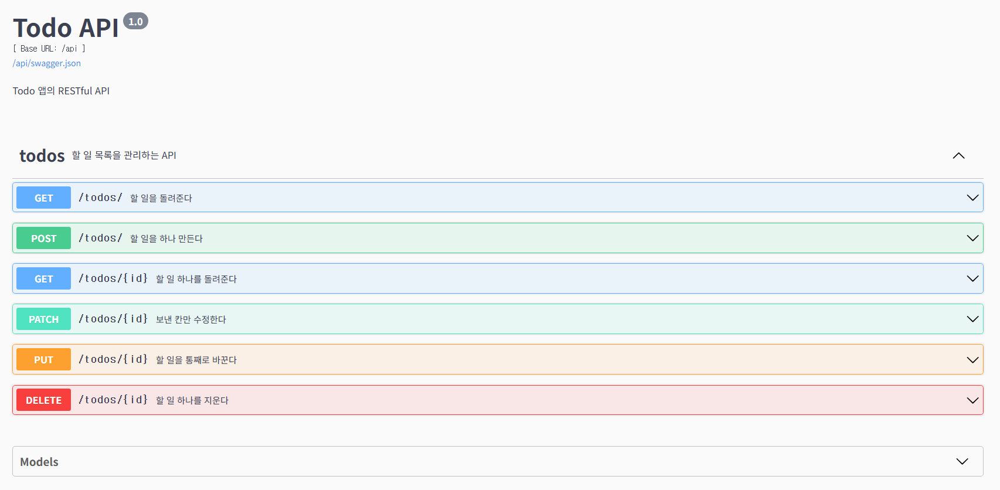
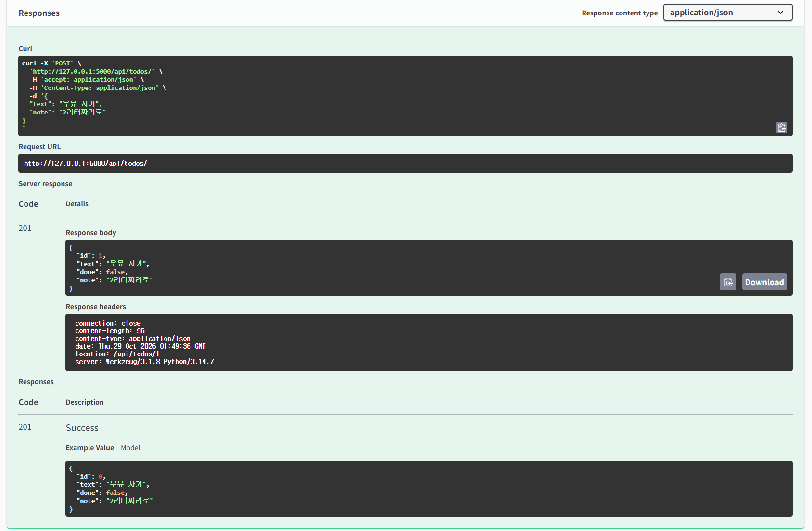
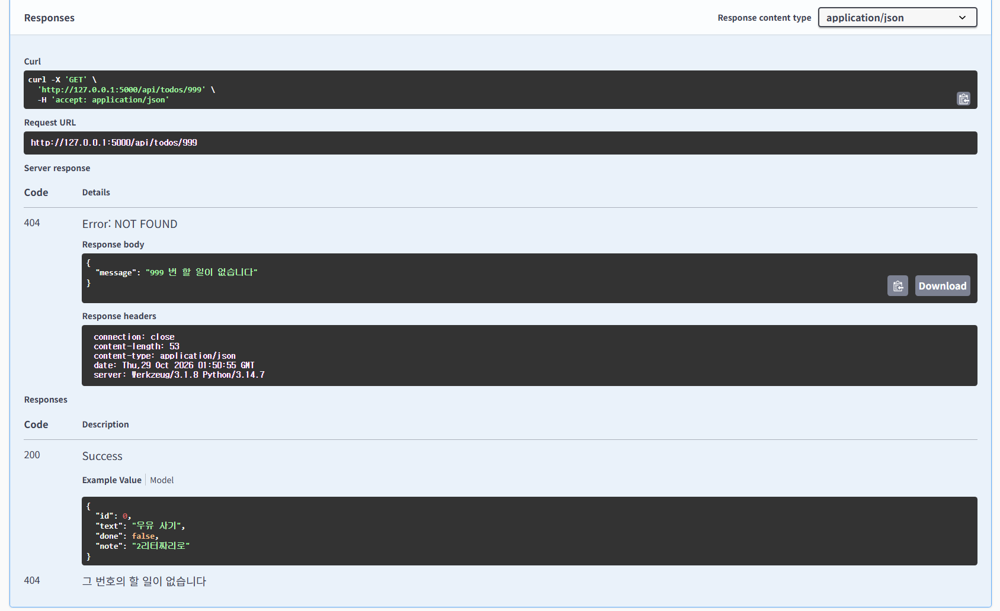

# HW4 : todo 앱에 API 더하기

## 더한 기능

- RESTful API를 사용하여 할 일 목록을 조회, 추가, 수정, 삭제할 수 있습니다.
- 설명 칸(note)을 API로도 주고받을 수 있습니다.
- GET /api/todos/?done=true 로 완료한 할 일만 조회할 수 있습니다.
- GET /api/todos/?done=false 로 완료되지 않은 할 일만 조회할 수 있습니다.
- Swagger UI를 통해 API를 확인할 수 있습니다.

## 실행하는 법

프로젝트 최상위 폴더에서:

    pip install -r requirements.txt
    cd HW4
    flask --debug run

웹 화면:

    http://127.0.0.1:5000/

API 문서:

    http://127.0.0.1:5000/api/docs

API 테스트:

    python -m unittest -v

## 화면

### 1. Swagger UI - API 주소 목록

### 2. note를 포함한 POST 요청 - 201 Created

### 3. 존재하지 않는 번호 조회 - 404 Not Found

